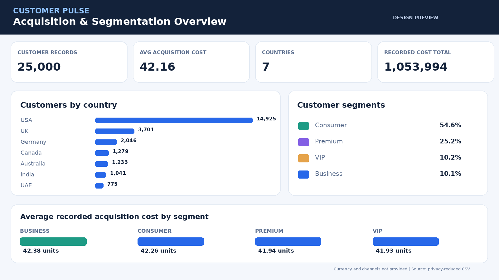
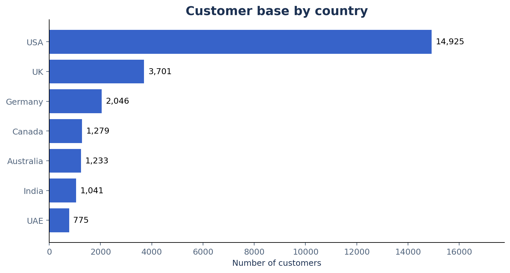

# Customer Acquisition & Segmentation Analytics

**Python · pandas · SQL · Power BI (PBIP/PBIR + DAX) · Plotly · Excel**

An end-to-end analytics case study examining customer distribution, recorded acquisition costs, and data-quality issues across countries and customer segments. This repository includes an executable analysis notebook, a repeatable Python pipeline, 10 SQLite queries, static visualizations, a browser-based interactive dashboard, and an editable 3-page Power BI Project (PBIP).

> **Data note:** The source file may contain simulated customer data; its provenance and publication rights have not been confirmed. This project uses a **privacy-reduced analytical extract** that omits original names, IDs, city/state and raw postal codes. Reduced identifiers are not a guarantee of anonymity. Review your permission to publish even this derived dataset before making the repository public.

## Power BI dashboard (editable source)

**[Open the Power BI project](powerbi/Customer_Acquisition.pbip)** ·
**[Power BI setup and DAX documentation](powerbi/README.md)**



*Design preview based on real customer aggregates, not an exported Power BI screenshot. Dashboard colors/layout may differ slightly after Power BI Desktop renders the PBIP.*

Added a native Power BI project containing **three pages and 26 visuals**: Executive
Overview, Customer Segmentation, and Data Quality. Includes measure-based cards,
charts and slicers backed by a Power Query semantic model and DAX measures. Power BI
Desktop is required to refresh from the local `data/public/customer_analytics.csv`;
update the `Customer_CSV_Path` parameter on first open. See the linked instructions.

Power BI source files are included and structurally validated; they have **not
been rendered or tested in Power BI Desktop** here. Save as `.pbix` from Desktop
once opened and refreshed. No fabricated PBIX file is included.

## Dashboard preview



**[Open the interactive dashboard](dashboard/customer_dashboard.html)** · [Read full analysis](reports/analysis_report.md) · [Explore the Jupyter notebook](notebooks/customer_analysis.ipynb)

The standalone dashboard opens locally in a browser, works without internet, and has interactive country, segment, region and gender filters.

## Objective

Understand the distribution and characteristics of 25,000 customer records, compare their reported acquisition costs, and identify data-quality concerns that could affect analysis.

**Questions explored:**

1. Which countries and segments have the largest customer counts?
2. How do recorded costs vary among countries, segments, and demographics?
3. Is age associated with customer acquisition cost?
4. Are the supplied geographical fields consistent enough for downstream analysis?

## Key results

| KPI | Finding |
|---|---:|
| Customer records | **25,000** |
| Countries | **7** |
| Segments | **4** |
| Largest country | **USA — 14,925 (59.7%)** |
| Largest segment | **Consumer — 13,638 (54.6%)** |
| Mean recorded acquisition cost | **42.16 units** |
| Total of per-customer cost entries | **1,053,993.76 units** |
| Postal-format mismatches in checked countries | **7,254** |

The cost currency is **not specified**. Comparisons using one-way ANOVA found negligible between-group differences in mean recorded cost for segments (p≈0.683) or countries (p≈0.664). This does **not** prove the group means are equal, and it does not show actual marketing efficiency. Age had approximately zero *linear* correlation with recorded cost in this sample.

The postal-format result was derived by checking postal-code **patterns** in the original source and preserving only the resulting status flags. It is not a verified-address test; UAE entries were not assessed.

## Project structure

```text
customer-acquisition-segmentation/
├── README.md
├── .gitignore
├── requirements.txt
├── Customer_Analytics_Summary.xlsx
├── powerbi/                          # Editable Power BI project (PBIP/PBIR/TMDL)
│   ├── README.md                     # Open / refresh / DAX setup
│   ├── Customer_Acquisition.pbip
│   ├── Customer_Acquisition.Report/
│   └── Customer_Acquisition.SemanticModel/
├── data/
│   ├── README.md                      # Data dictionary & privacy notes
│   └── public/
│       └── customer_analytics.csv    # Privacy-reduced analytical extract
├── notebooks/
│   └── customer_analysis.ipynb       # Executed EDA notebook with explanations
├── src/
│   ├── prepare_public_data.py        # OPTIONAL: build extract from PRIVATE source
│   ├── analyze_customers.py         # Generate reports, charts, SQLite tables
│   └── build_dashboard.py           # Rebuild standalone dashboard
├── sql/
│   └── analysis_queries.sql         # 10 SQL queries
├── dashboard/
│   └── customer_dashboard.html      # Self-contained interactive dashboard
├── reports/
│   ├── analysis_report.md           # Findings & interpretation
│   ├── data_quality_report.json
│   ├── statistical_tests.json
│   ├── charts/                      # 8 PNG charts
│   └── tables/                      # Aggregated CSVs
└── tests/
    └── test_analysis.py             # Unittest smoke/data checks
```

`data/processed/` and `sql/customers.sqlite` are **generated locally** and ignored by Git. No original customer master CSV is included.

## Run it yourself

Tested with Python 3.11+ and a standard Python 3 Jupyter kernel.

**Windows PowerShell** (from the repository folder):

```powershell
py -m venv .venv
.\.venv\Scripts\python -m pip install -r requirements.txt
.\.venv\Scripts\python src/analyze_customers.py
.\.venv\Scripts\python src/build_dashboard.py
.\.venv\Scripts\python -m unittest discover -s tests -v
.\.venv\Scripts\python -m notebook
```

**macOS / Linux**:

```bash
python3 -m venv .venv
.venv/bin/python -m pip install -r requirements.txt
.venv/bin/python src/analyze_customers.py
.venv/bin/python src/build_dashboard.py
.venv/bin/python -m unittest discover -s tests -v
.venv/bin/python -m notebook
```

Open `notebooks/customer_analysis.ipynb` and select **Run All**. To explore the SQL exercise, open the generated `sql/customers.sqlite` with SQLite tools and run the statements in `sql/analysis_queries.sql`.

If you have the original customer master and are **authorized** to use it, you can rebuild the reduced extract locally:

```bash
python src/prepare_public_data.py /private/path/customer_master.csv
```

Do not commit the original CSV or any file containing real customer identifiers. Review the regenerated extract for residual disclosure risk and data rights before publishing.

## Methods and skills

- **Python & pandas:** schema checks, null and duplicate validation, group-by analysis, age and cost-band features.
- **Data quality:** country-specific postal-format checks performed on the private input, with only resulting flags exported.
- **Statistics:** descriptive metrics, Pearson correlation, chi-square, ANOVA and effect size; appropriate limits on inference.
- **SQL:** aggregation, conditional logic, window functions (`NTILE`) and validation queries.
- **Visualization:** matplotlib static charts and a responsive, interactive Plotly dashboard.
- **Power BI:** PBIP/PBIR project files, Power Query import transformations, DAX measures, slicers and report pages.
- **Reporting:** spreadsheet summary, reproducible tables and documented business recommendations.

## Important limitations

The dataset does **not** include documented acquisition dates, channels, campaign budgets, transactions, revenue or retention data. Consequently, this is **not** a study of real CAC by channel, ROI, marketing attribution, seasonality, or CLV. Geography and segment labels are unverified; the data may be artificially generated. Results describe this dataset only and should not drive actual marketing decisions without source validation.

## Portfolio description

**Customer Acquisition & Segmentation Analytics** — Analyzed 25,000 customer records with Python, pandas and SQL; assessed geographic data quality, explored segment- and market-level cost patterns, performed statistical comparisons, and created a reproducible reporting pipeline with interactive Plotly and Power BI dashboards.
